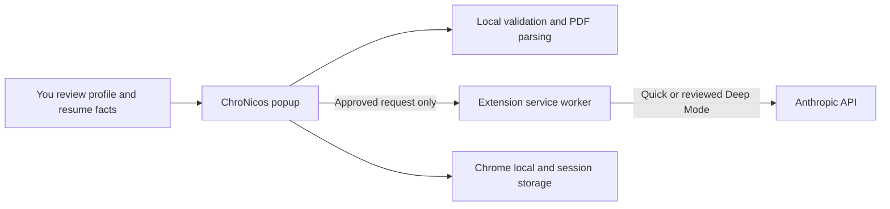

<p align="center">
  
</p>

<h1 align="center">ChroNicos</h1>

<p align="center">
  A privacy-conscious Chrome extension for thoughtful, user-reviewed professional outreach.
</p>

| Release | Development | Community |
| --- | --- | --- |
|  <br>  <br> [](LICENSE) | [](https://github.com/harshanavasana/ChroNicos/actions/workflows/ci.yml) <br>  <br>  | [](https://github.com/harshanavasana/ChroNicos/issues) <br> [](CONTRIBUTING.md) <br> [](CODE_OF_CONDUCT.md) |

ChroNicos helps you draft personalized networking messages from profile details you enter and review. It does **not** scrape LinkedIn. You decide what information to include and approve each request that sends information to Anthropic.

## Features

- **Quick Mode:** drafts outreach from reviewed recipient details and, optionally, selected resume facts.
- **Deep Mode:** researches public professional sources, excludes LinkedIn, shows cited findings for review, then drafts a message only after your approval.
- **Local resume processing:** extracts selectable PDF text in the extension; the original PDF is not uploaded.
- **Message safeguards:** locally checks drafts for issues such as placeholders, duplicates, URLs, and private contact details.
- **Failure recovery:** reports API, network, storage, and parsing errors while preserving saved user data and allowing safe retries.

## Try it locally

**Requirements:** Chrome 103 or newer and Node.js 22.13+ or 24+.

1. Clone the repository and install dependencies:

   ```sh
   git clone https://github.com/harshanavasana/ChroNicos.git
   cd ChroNicos
   npm ci
   ```

2. Open `chrome://extensions`, enable **Developer mode**, select **Load unpacked**, and choose the repository folder.
3. For AI features, add your Anthropic API key in the extension's Settings. Quick Mode also supports local drafting without a key; Deep Mode requires a key and Anthropic web-search access.

## How it works



## Privacy at a glance

- Recipient details are entered and reviewed by you; the extension does not read LinkedIn pages.
- Resume PDFs are parsed locally. Resume inclusion is off by default, and you choose which extracted facts to share.
- Each external AI or research operation requires approval. Deep Mode displays cited findings before message generation.
- The API key is kept in Chrome session storage and is not included in prompts. Session storage is not encrypted secret storage.
- Preferences and structured resume details remain in Chrome local storage. Recent messages are local-only and expire according to your selected retention period.

See the implementation and recovery details in the [privacy and data-handling notes](#data-handling-details).

## Run checks

```sh
npm test                 # Vitest and Node integration tests
npm run test:coverage    # Coverage report for core modules
npm run test:e2e         # Real Chromium extension popup workflows
npm run lint             # ESLint
npm run check:manifest   # Manifest permissions and referenced files
npm run check:deps       # Dependency vulnerability audit
npm run test:all         # Full local quality and browser pipeline
```

The Playwright tests use isolated browser profiles and do not call Anthropic. GitHub Actions runs quality and browser checks for pull requests to `main` and pushes to `main` or `develop`. Configure both jobs as required status checks in GitHub branch protection if merges must wait for them.

## Data handling details

PDF.js extracts selectable text inside the extension. The PDF itself is neither stored nor sent to a service; only structured resume sections are saved in Chrome local storage. Scanned/image-only PDFs are not supported. Email addresses, phone numbers, and recognizable street-address lines are filtered from resume details before storage and prompting.

Quick Mode does not search the web. Deep Mode makes a bounded public web search (at most five searches) and blocks LinkedIn as a search domain. It sends only approved professional details and selected resume facts; review the request preview and cited research before continuing. Missing or unsupported facts are not filled in by the extension.

Generated messages receive local checks for empty content, limits, placeholders, duplicate sentences, basic formatting, URLs, and private contact details. AI-backed generation produces three variations for one batched evaluation; automatic rewriting is limited to two attempts.

Generation and Deep Mode research use request IDs. The service worker stores only the operation ID, kind/state, timestamps, and a short-lived completed result in Chrome session storage—not the submitted profile, resume, or prompts. Records expire after 15 minutes. A request interrupted by service-worker termination is marked failed rather than replayed; reopening the popup can reconnect to or recover an operation.

## Project layout

```text
.
├── assets/       # README branding
├── e2e/          # Playwright extension workflows
├── tests/        # Node integration and regression tests
├── utils/        # Shared extension helpers
├── vitest/       # Unit and integration-focused tests
└── .github/      # CI workflow
```

## License and community

ChroNicos is available under the [MIT License](LICENSE). Contributions are welcome; please read the [contribution guide](CONTRIBUTING.md) and follow the [Code of Conduct](CODE_OF_CONDUCT.md).
